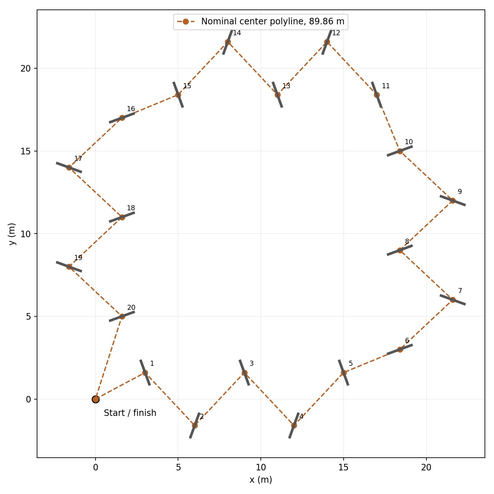

# 20门长闭环交错赛道实验

2026-11-16。按用户希望长赛道上突出自由选点优势，设计20门闭环。起终点(0,0,3)米、零VAJ，四条路段各5门，路段内纵向间距3米，横向交替±1.6米，门朝向相对路段交替±20度。方窗和圆窗交替，开口1.5米，全门独立平移/摆动，幅度0.20～0.26米，频率1.5～2.1Hz。

## 求解前几何筛选

第一几何候选inputs_v1中心折线缩短空间5.93%；增大交错后的候选因角部框包络过近被拒绝。最后inputs_v3在任何轨迹求解前固定，中心闭环折线89.862米，允许区内侧点示意折线81.873米，几何长度差8.890%，运动框包络最小间距1.914米。该几何指标没有施加平滑动力学和连续安全，不代表竞速时间增益。v1/v2没有进行轨迹优化。

## 正式结果

当前完整PVAJ MINCO、独立正时间映射、动力学软权重1000、时间权重1、安全球0.30米、内缩0.3001米。原8组时间模式，各自用目标场景TOGT中心时间初始化恢复实际PVAJ，给自由/中心相同对应初值。16候选并行，单有限问题5000次、外层24轮。求解前冻结场景与二进制。

|方法|完整验收通过|竞速时间|并行计算墙钟，含初始化|
|---|---|---|---|
|自由点|0/8|未找到|930.845秒|
|强制中心|0/8|未找到|933.103秒|

自由点8个都以Maximum_Iterations_Exceeded结束，7个发生在补入首批安全约束后的第二个有限问题，1个发生在首轮。中心3个达到上限、5个返回Infeasible_Problem_Detected，未进入完整接纳。首轮有收敛候选的原目标约自由10.111秒、中心11.674秒，均未通过最终安全验收，不作为竞速成绩。

## 每个候选

|候选|有限问题调用数|最终IPOPT状态|最终有限残差|
|---|---|---|---|
|center_0|4|Maximum_Iterations_Exceeded|0.00135536|
|center_1|6|Infeasible_Problem_Detected|0|
|center_2|1|Maximum_Iterations_Exceeded|0|
|center_3|3|Infeasible_Problem_Detected|0|
|center_4|20|Infeasible_Problem_Detected|0|
|center_5|4|Infeasible_Problem_Detected|0|
|center_6|5|Maximum_Iterations_Exceeded|1.83972|
|center_7|3|Infeasible_Problem_Detected|0|
|ours_0|2|Maximum_Iterations_Exceeded|0.0925588|
|ours_1|2|Maximum_Iterations_Exceeded|0.0928281|
|ours_2|2|Maximum_Iterations_Exceeded|0.771951|
|ours_3|2|Maximum_Iterations_Exceeded|0.0926586|
|ours_4|1|Maximum_Iterations_Exceeded|3.81163|
|ours_5|2|Maximum_Iterations_Exceeded|0.092667|
|ours_6|2|Maximum_Iterations_Exceeded|1269.33|
|ours_7|2|Maximum_Iterations_Exceeded|0.0927624|

当前结果表明统一求解流程在该场景上没有找到合格解，不能确认自由点大幅提速，也不能推断赛道无解。后续若改进求解，应继续解此冻结场景并单列新版本。本次未修改生产算法，没有Gazebo实飞。

C++生成器为generate.cpp，正式输入在results/inputs_v3，协议PROTOCOL.md，冻结FREEZE.json。原始有限优化、复查及失败状态均保存在[候选目录](results/paired_v1/long_closed/candidates)，[完整汇总](results/paired_v1/SUMMARY.json)、[C++独立审计](results/paired_v1/DATA_AUDIT.json)、[最终审核](results/paired_v1/FINAL_AUDIT.json)。
