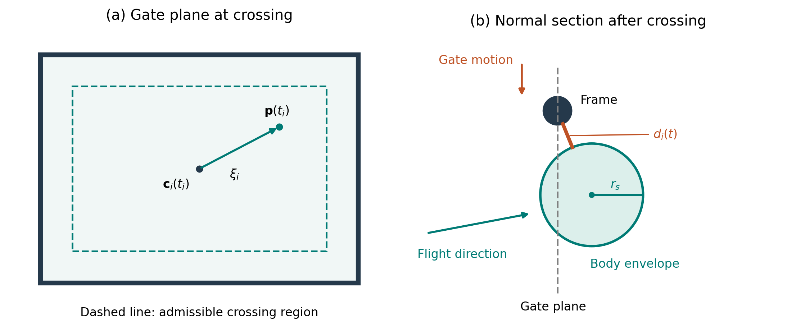

# 3　系统模型与问题表述

考虑一架四旋翼依次穿过 $M$ 扇运动窗口的竞速任务。给定起终状态、穿越顺序及各窗口相对于比赛时钟的运动规律，求解从起点到终点的全程轨迹。总飞行时间 $T$ 包含最后一扇窗口至终点的航段。

## 3.1　四旋翼模型

取竖直向上的惯性坐标系 $\mathcal W$ 和原点位于质心的机体坐标系 $\mathcal B$。记 $\mathbf p,\mathbf v\in\mathbb R^3$ 为质心在 $\mathcal W$ 中的位置和速度，$\mathbf R\in SO(3)$ 为从 $\mathcal B$ 到 $\mathcal W$ 的旋转，$\boldsymbol\omega$ 为机体系角速度。采用竞速规划中常用的单旋翼推力输入 $\mathbf f=[f_1,f_2,f_3,f_4]^\top$。忽略气动阻力时，四旋翼满足 [1]

$$
\begin{aligned}
\dot{\mathbf p}&=\mathbf v, &
m\dot{\mathbf v}&=f_\Sigma\mathbf R\mathbf e_3-mg\mathbf e_3,\\
\dot{\mathbf R}&=\mathbf R[\boldsymbol\omega]_\times, &
\mathbf J\dot{\boldsymbol\omega}
&=\boldsymbol\tau-\boldsymbol\omega\times(\mathbf J\boldsymbol\omega).
\end{aligned}\tag{1}
$$

其中 $m$ 和 $\mathbf J$ 分别为质量和机体系惯量矩阵，$\mathbf e_3=[0,0,1]^\top$，且 $[\mathbf a]_\times\mathbf b=\mathbf a\times\mathbf b$。总推力 $f_\Sigma=\sum_{j=1}^4 f_j$ 与机体系力矩 $\boldsymbol\tau$ 由推力分配关系 $[f_\Sigma,\boldsymbol\tau^\top]^\top=\mathbf B\mathbf f$ 给出。由式（1），当总推力为正时，$\ddot{\mathbf p}+g\mathbf e_3$ 的方向即为机体推力轴。在给定航向约定后，可由位置轨迹及其高阶导数恢复角速度和各旋翼推力，用于评价轨迹的动力学代价。

## 3.2　运动窗口与穿越事件

**图 1　运动窗口的穿越几何。**（a）在穿越时刻 $t_i$，门内坐标决定质心在内缩开口中的位置。（b）以横移门为例，在稍后的时刻 $t>t_i$，质心已越过门平面，规划包络仍与该平面相交。橙色线段表示包络表面至门框表面的净空。两图为不同截面的模型示意。

以凸开口表示可选穿越位置 [2]。对于窗口 $i$，令 $\mathcal A_i\subset\mathbb R^2$ 为门坐标系中的净开口，$\mathbf c_i(t)$ 为门中心在 $\mathcal W$ 中的位置，$\mathbf E_i(t)=[\mathbf e_{i1}(t),\mathbf e_{i2}(t)]$ 为门平面的正交单位基。其正向法向量为 $\mathbf n_i(t)=\mathbf e_{i1}(t)\times\mathbf e_{i2}(t)$。门中心和平面基均为已知时间函数，可分别描述各窗口的平移或绕外部支点的摆动。

设 $t_i$ 为第 $i$ 扇门的计划穿越时刻，$\boldsymbol\xi_i\in\mathbb R^2$ 为相应的门内坐标。穿越条件为

$$
\mathbf p(t_i)=\mathbf c_i(t_i)+\mathbf E_i(t_i)\boldsymbol\xi_i,
\qquad 0<t_1<\cdots<t_M<T .\tag{2}
$$

式（2）将穿越时刻与空间位置耦合。即使固定 $\boldsymbol\xi_i$，改变 $t_i$ 也会改变对应的世界坐标。强制中心方案取 $\boldsymbol\xi_i=\mathbf 0$，自由选点方案则在内缩开口内优化 $\boldsymbol\xi_i$。设 $r_s$ 为机体规划包络球半径。对净半径为 $a_i$ 的圆窗，要求 $\|\boldsymbol\xi_i\|_2\le a_i-r_s$；对边界由 $\mathbf b_{ik}^{\top}\boldsymbol\xi\le d_{ik}$ 给出的四边形窗，要求每条边均满足 $\mathbf b_{ik}^{\top}\boldsymbol\xi_i\le d_{ik}-r_s$，其中 $\mathbf b_{ik}$ 是单位外法向量。

实际穿越事件由质心相对门平面的有符号距离 $h_i(t)=\mathbf n_i(t)^\top[\mathbf p(t)-\mathbf c_i(t)]$ 确定。一次正向穿越要求 $h_i$ 由负变正，且零点对应的交点位于开口内。全程任务据此核对门序及重复穿越。赛道中另设的导航航点按其指定邻域判定到达。

## 3.3　整机净空与竞速目标

当 $h_i(t_i)=0$ 时，式（2）确定了质心在门平面内的位置。由于机体具有有限尺度，在该时刻前后均可能与移动的门框相交。令 $\mathcal F_i(t)\subset\mathbb R^3$ 表示时刻 $t$ 的实体门框，定义规划净空为

$$
d_i(t)=\inf_{\mathbf y\in\mathcal F_i(t)}
          \|\mathbf p(t)-\mathbf y\|_2-r_s .
\tag{3}
$$

整机净空要求 $d_i(t)\ge0$ 对每扇门及所有 $t\in[0,T]$ 成立。式（3）中的距离量至门框实体表面；采用圆管中心线计算时，须同时扣除管半径与机体包络半径。规划取 $r_s=0.20\,\mathrm m$，轨迹的独立碰撞评估取物理机体半径 $r_b=0.15\,\mathrm m$。

在给定边界状态下，本文联合优化轨迹、穿越时刻及门内坐标。目标函数由全程时间 $T$ 与角速度、单旋翼推力的越限惩罚组成。式（2）及内缩开口限定各次穿越的位置，式（3）限定整个穿越过程中的机体净空。下一节给出轨迹参数化、惩罚积分及连续净空约束的数值求解方法。

**本节参考文献**

[1] P. Foehn, A. Romero, D. Scaramuzza. [Time-optimal planning for quadrotor waypoint flight](https://doi.org/10.1126/scirobotics.abh1221). Science Robotics, 2021.

[2] C. Qin, M. S. J. Michet, J. Chen, H. H.-T. Liu. [Time-Optimal Gate-Traversing Planner for Autonomous Drone Racing](https://github.com/FSC-Lab/TOGT). IEEE International Conference on Robotics and Automation, 2024.
